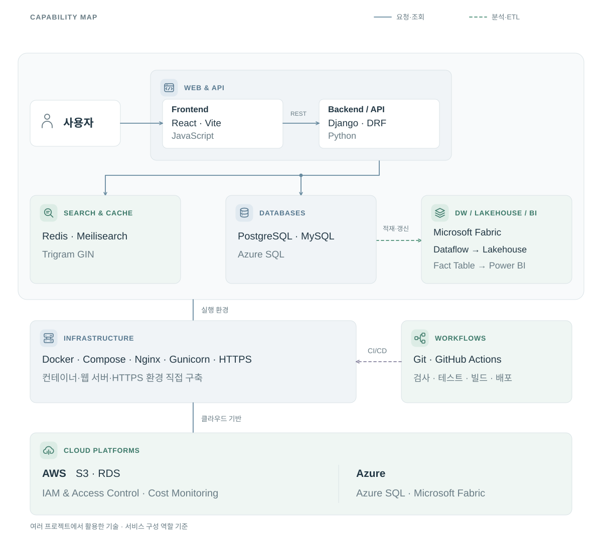

  <picture><source media="(prefers-color-scheme: dark)" srcset="assets/profile-cover-dark.svg" /><source media="(prefers-color-scheme: light)" srcset="assets/profile-cover-light.svg" /></picture>

### 클라우드 환경과 데이터 서비스를 만듭니다.

AWS·Azure 환경을 구성하고, 
데이터를 저장·검색·분석하는 웹 서비스를 개발합니다.

 

## Capabilities

<picture><source media="(prefers-color-scheme: dark)" srcset="assets/capabilities-map-dark.svg" /><source media="(prefers-color-scheme: light)" srcset="assets/capabilities-map-light.svg" /></picture>

기술 목록

- **Web & API**: JavaScript · React · Vite · Python · Django · DRF
- **Search & Cache**: Redis · Meilisearch · Trigram GIN
- **Databases**: PostgreSQL · MySQL · Azure SQL
- **DW / Lakehouse / BI**: Microsoft Fabric · Dataflow · Lakehouse · Fact Table · Power BI
- **Infrastructure**: Docker · Compose · Nginx · Gunicorn · HTTPS
- **Workflows**: Git · GitHub Actions · Fabric Dataflow
- **Cloud**: AWS S3 · RDS · IAM & Access Control · Cost Monitoring / Azure SQL · Microsoft Fabric

## Selected Work

###  데이터 탐색·분석 플랫폼

IN PROGRESS · PRIVATE PROJECT

통합 검색·필터·시각화·파일 내보내기를 제공하는 데이터 분석 플랫폼을 개발하고 있습니다.

**서비스 인프라 전반을 직접 구축하고, 배포를 자동화했습니다.**

 

###  [ITC · Investment Training Crypto](https://github.com/wwiskey/ITC)

2025.08–09 · TEAM PROJECT · PM / DATA ENGINEER · ARCHIVED

코인 투자 시뮬레이션으로 매매를 연습하고 경제를 공부하는 학습 서비스입니다.

[프로젝트 소개 ↗](https://github.com/wwiskey/ITC/blob/main/README.md) · [실행 시연 ↗](https://github.com/wwiskey/ITC#서비스-화면) · [소스 코드 ↗](https://github.com/wwiskey/ITC/tree/main/src)

현재는 외부 리소스가 삭제되어 소스와 과거 시연을 보관하고 있습니다.
