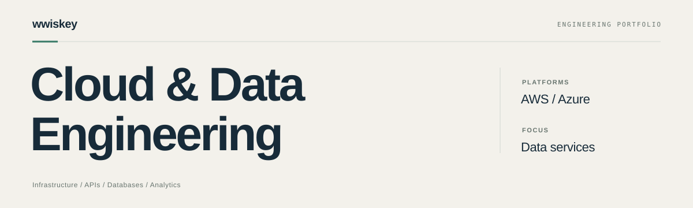
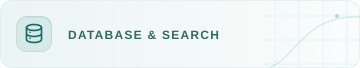

  <picture><source media="(prefers-color-scheme: dark)" srcset="assets/profile-cover-dark.svg" /><source media="(prefers-color-scheme: light)" srcset="assets/profile-cover-light.svg" /></picture>

### 클라우드 환경과 데이터 서비스를 만듭니다.

AWS·Azure 환경을 구성하고, 
데이터를 저장·검색·분석하는 웹 서비스를 개발합니다.

 

## Capabilities

<table>
  <tr>
    <td width="50%" valign="top">
      
<picture><source media="(prefers-color-scheme: dark)" srcset="assets/labels/capability-cloud-dark.svg" /><source media="(prefers-color-scheme: light)" srcset="assets/labels/capability-cloud-light.svg" /></picture>

      
<strong>AWS</strong> <code>S3</code> <code>RDS</code> <code>IAM &amp; Access Control</code> <code>Cost Monitoring</code>

      
<strong>Azure</strong> <code>Azure SQL</code> <code>Microsoft Fabric</code>

    </td>
    <td width="50%" valign="top">
      
<picture><source media="(prefers-color-scheme: dark)" srcset="assets/labels/capability-database-dark.svg" /><source media="(prefers-color-scheme: light)" srcset="assets/labels/capability-database-light.svg" /></picture>

      
<code>PostgreSQL</code> <code>MySQL</code> <code>Azure SQL</code>

      
관계형 데이터 모델·SQL 조회·집계·인덱스 구성

    </td>
  </tr>
  <tr>
    <td width="50%" valign="top">
      
<picture><source media="(prefers-color-scheme: dark)" srcset="assets/labels/capability-web-dark.svg" /><source media="(prefers-color-scheme: light)" srcset="assets/labels/capability-web-light.svg" /></picture>

      
<code>Python</code> <code>Django</code> <code>DRF</code> <code>JavaScript</code> <code>React</code> <code>Vite</code>

      
REST API와 검색·필터·통계·시각화를 연결한 웹 개발

    </td>
    <td width="50%" valign="top">
      
<picture><source media="(prefers-color-scheme: dark)" srcset="assets/labels/capability-search-dark.svg" /><source media="(prefers-color-scheme: light)" srcset="assets/labels/capability-search-light.svg" /></picture>

      
<strong>캐시</strong> <code>Redis</code> <strong>검색</strong> <code>Meilisearch</code> <code>Trigram GIN</code>

      
필터별 캐시·검색 색인과 검색 장애 시 DB 대체 경로 구성

    </td>
  </tr>
  <tr>
    <td width="50%" valign="top">
      
<picture><source media="(prefers-color-scheme: dark)" srcset="assets/labels/capability-data-formats-dark.svg" /><source media="(prefers-color-scheme: light)" srcset="assets/labels/capability-data-formats-light.svg" /></picture>

      
<strong>정형</strong> <code>SQL Tables</code> <code>TSV</code> <strong>반정형</strong> <code>JSON</code>

      
테이블 조회·집계, JSON 연동과 TSV·ZIP 내보내기

    </td>
    <td width="50%" valign="top">
      
<picture><source media="(prefers-color-scheme: dark)" srcset="assets/labels/capability-analytics-dark.svg" /><source media="(prefers-color-scheme: light)" srcset="assets/labels/capability-analytics-light.svg" /></picture>

      
<code>Microsoft Fabric</code> <code>Lakehouse</code> <code>Fact Table</code> <code>Power BI</code>

      
Lakehouse 적재·변환과 분석용 테이블·운영 대시보드 구성

    </td>
  </tr>
  <tr>
    <td width="50%" valign="top">
      
<picture><source media="(prefers-color-scheme: dark)" srcset="assets/labels/capability-infrastructure-dark.svg" /><source media="(prefers-color-scheme: light)" srcset="assets/labels/capability-infrastructure-light.svg" /></picture>

      
<code>Docker</code> <code>Compose</code> <code>Nginx</code> <code>Gunicorn</code> <code>HTTPS</code>

      
앱·검색·캐시 컨테이너와 웹 서버·HTTPS 환경 직접 설계·구축

    </td>
    <td width="50%" valign="top">
      
<picture><source media="(prefers-color-scheme: dark)" srcset="assets/labels/capability-workflows-dark.svg" /><source media="(prefers-color-scheme: light)" srcset="assets/labels/capability-workflows-light.svg" /></picture>

      
<strong>ETL</strong> <code>Fabric Dataflow</code> <strong>개발·배포</strong> <code>Git</code> <code>GitHub Actions</code>

      
데이터 처리·주기적 BI 갱신과 검사·테스트·빌드·배포 자동화

    </td>
  </tr>
</table>

## Selected Work

###  데이터 탐색·분석 플랫폼

IN PROGRESS · PRIVATE PROJECT

통합 검색·필터·시각화·파일 내보내기를 제공하는 데이터 분석 플랫폼을 개발하고 있습니다.

**서비스 인프라 전반을 직접 구축하고, 배포를 자동화했습니다.**

 

###  [ITC · Investment Training Crypto](https://github.com/wwiskey/ITC)

2025.08–09 · TEAM PROJECT · PM / DATA ENGINEER · ARCHIVED

코인 투자 시뮬레이션으로 매매를 연습하고 경제를 공부하는 학습 서비스입니다.

[프로젝트 소개 ↗](https://github.com/wwiskey/ITC/blob/main/README.md) · [실행 시연 ↗](https://github.com/wwiskey/ITC#서비스-화면) · [소스 코드 ↗](https://github.com/wwiskey/ITC/tree/main/src)

현재는 외부 리소스가 삭제되어 소스와 과거 시연을 보관하고 있습니다.
