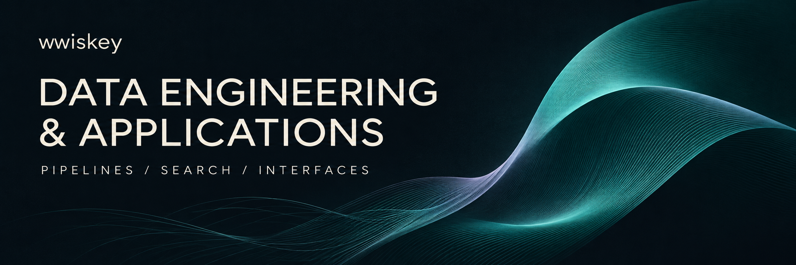

<p align="center">
  
</p>

<div align="center">

### 데이터의 구조부터, 사용자의 탐색 경험까지.

데이터를 분석 가능한 구조로 정리하고,<br />
검색·API·시각화를 연결해 필요한 정보를 찾을 수 있는 서비스를 만듭니다.

[Selected Work](#selected-work) · [Capabilities](#capabilities) · [ITC 시연](https://github.com/wwiskey/ITC#서비스-화면)

</div>

<br />

<table>
  <tr>
    <td width="50%" valign="top">
      <p><picture><source media="(prefers-color-scheme: dark)" srcset="assets/labels/systems-dark.svg" /><source media="(prefers-color-scheme: light)" srcset="assets/labels/systems-light.svg" /></picture></p>
      <h3>분석할 수 있는 데이터 구조</h3>
      <p>수집·변환·적재에서 분석용 테이블과 운영 대시보드까지, 데이터가 활용되는 흐름을 연결합니다.</p>
      <p><code>SQL</code> <code>Fabric</code> <code>Lakehouse</code> <code>Power BI</code></p>
    </td>
    <td width="50%" valign="top">
      <p><picture><source media="(prefers-color-scheme: dark)" srcset="assets/labels/applications-dark.svg" /><source media="(prefers-color-scheme: light)" srcset="assets/labels/applications-light.svg" /></picture></p>
      <h3>탐색할 수 있는 데이터 서비스</h3>
      <p>API·검색·캐시와 인터랙티브 화면을 연결해 데이터를 찾고, 비교하고, 해석하는 경험을 구성합니다.</p>
      <p><code>Django</code> <code>PostgreSQL</code> <code>React</code> <code>Redis</code></p>
    </td>
  </tr>
</table>

## Selected Work

###  데이터 탐색·분석 포털

<sub>IN PROGRESS · PRIVATE PROJECT</sub>

**검색과 필터, 차트가 하나로 연결된 데이터 탐색 서비스.**

Django·PostgreSQL 기반 API와 React 화면을 연결하고, 여러 유형의 데이터를 조건에 따라 탐색하고 비교할 수 있도록 개발하고 있습니다.

| 데이터 접근 | 탐색 경험 | 개발·배포 |
| :--- | :--- | :--- |
| 모델·인덱스와 집계 쿼리 | 통합 검색·자동완성·필터 | Docker · Compose · Nginx |
| Redis 캐시 · Meilisearch | 차트·표 연동, 결과 내보내기 | GitHub Actions 검사·테스트·배포 |

<br />

###  [ITC · Investment Training Crypto](https://github.com/wwiskey/ITC)

<sub>2025.08–09 · TEAM PROJECT · ARCHIVED</sub>

**투자 학습 서비스의 경험 설계와 운영 데이터 분석.**

6인 팀에서 <strong>PM & Data Engineer</strong>를 맡아 로드맵·시장 시나리오·학습 콘텐츠를 설계하고, 서비스 데이터를 운영 분석으로 연결했습니다.

```text
Azure SQL → Fabric Dataflow → Lakehouse → Fact Table → Power BI
```

- 고객 특성·선호 코인·주문 방식·거래량을 분석하는 대시보드
- 1시간 단위 갱신 구성과 데이터 연결·테이블 매핑 문제 해결
- 세 가지 시장 시나리오 설계, 로드맵·리스크·기능 진행 조율

[프로젝트 소개 ↗](https://github.com/wwiskey/ITC/blob/main/README.md) · [실행 시연 ↗](https://github.com/wwiskey/ITC#서비스-화면) · [소스 코드 ↗](https://github.com/wwiskey/ITC/tree/main/src)

<sub>웹·거래 엔진·인증·AI·인프라는 팀 공동 산출물입니다. 현재는 기존 외부 리소스가 삭제되어 소스와 과거 시연을 보관하고 있습니다.</sub>

## Capabilities

프로젝트에서 다뤄온 기술을 작업 단위로 정리했습니다.

| 영역 | 기술과 경험 |
| :--- | :--- |
| **Data & APIs** | Python · SQL · Django · Django REST Framework · PostgreSQL |
| **Search & Retrieval** | Redis · Meilisearch · 인덱스 · 캐시 · 필터·집계 |
| **Interfaces** | JavaScript · React · Vite · Chart.js · SVG · 데이터 내보내기 |
| **Engineering & BI** | Azure SQL · Microsoft Fabric · Dataflow · Lakehouse · Power BI |
| **Delivery** | Docker · Compose · Nginx · GitHub Actions · PR 기반 작업·검증 |
